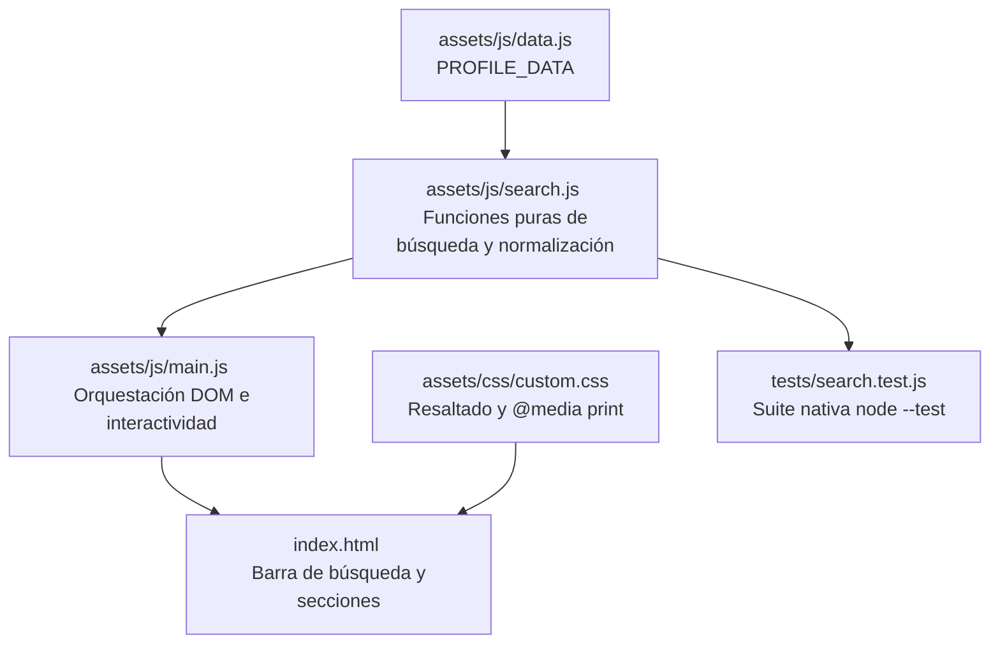

# Plan Técnico: Spec 001 — Buscador y Filtros Avanzados en Tiempo Real

## 1. Arquitectura y responsabilidades de archivos



### Archivos involucrados:
1. **`assets/js/search.js` (Nuevo):** Módulo de funciones puras de normalización, coincidencia, conteo y resaltado. Exportación condicional CommonJS para tests y objeto global para el navegador.
2. **`tests/search.test.js` (Nuevo):** Pruebas unitarias nativas ejecutadas con `node --test` (sin dependencias externas).
3. **`index.html`:** Maquetado de la sección del buscador (`#search-section`), input de texto, contador de coincidencias, botón de borrado y contenedor de estado "Sin coincidencias" (`#search-empty-state`).
4. **`assets/css/custom.css`:** Clases para resaltado de texto (`mark`), transiciones, estados y reglas `@media print` para forzar la visibilidad completa en el PDF.
5. **`assets/js/main.js`:** Enlace de eventos de entrada de texto, debounce ligero, interacción con los filtros de categoría de proyectos y renderizado reactivo.

---

## 2. Funciones puras (`assets/js/search.js`)

| Función | Parámetros | Retorno | Cobertura RF |
| :--- | :--- | :--- | :--- |
| `normalizarTexto(texto)` | `(texto: string)` | `string` normalizado (sin acentos, minúsculas, trim) | RF-2.1 |
| `escaparRegex(texto)` | `(texto: string)` | `string` con caracteres especiales de regex escapados | RF-2.3, Casos límite |
| `coincideTexto(fuente, busqueda)` | `(fuente: string, busqueda: string)` | `boolean` si la fuente normalizada contiene la búsqueda normalizada | RF-2.1, RF-2.2 |
| `resaltarCoincidencias(textoOriginal, busqueda)` | `(textoOriginal: string, busqueda: string)` | `string` HTML con etiquetas `<mark>` preservando mayúsculas/minúsculas originales | RF-2.3 |
| `filtrarHabilidades(technicalSkills, busqueda)` | `(skills: Object, busqueda: string)` | `Object` con categorías y lista de habilidades coincidentes (y texto resaltado) | RF-1.2, RF-2.2 |
| `filtrarProyectos(projects, categoria, busqueda)` | `(proyectos: Array, categoria: string, busqueda: string)` | `Array` de proyectos filtrados que satisfacen categoría y búsqueda | RF-1.2, RF-4.1, RF-4.2 |
| `filtrarExperiencia(experience, busqueda)` | `(experiencias: Array, busqueda: string)` | `Array` de experiencias laborales con logros coincidentes y resaltados | RF-1.2, RF-2.2 |
| `calcularTotalCoincidencias(habilidades, proyectos, experiencias)` | `(habilidades: Object, proyectos: Array, exp: Array)` | `number` total de elementos coincidentes encontrados | RF-3.1 |

---

## 3. Algoritmo y pseudocódigo del filtrado en tiempo real

```text
ALGORITMO procesarBusqueda(termino, categoriaActual):
  terminoLimpio = normalizarTexto(termino)
  
  SI terminoLimpio es vacío:
    restaurarRenderizadoCompleto(categoriaActual)
    ocultarContador()
    ocultarEstadoVacio()
    RETORNAR
  
  habilidadesFiltradas = filtrarHabilidades(PROFILE_DATA.technicalSkills, terminoLimpio)
  proyectosFiltrados = filtrarProyectos(PROFILE_DATA.projects, categoriaActual, terminoLimpio)
  experienciasFiltradas = filtrarExperiencia(PROFILE_DATA.experience, terminoLimpio)
  
  total = calcularTotalCoincidencias(habilidadesFiltradas, proyectosFiltrados, experienciasFiltradas)
  
  SI total == 0:
    mostrarEstadoVacio(termino)
    ocultarContador()
  SINO:
    ocultarEstadoVacio()
    mostrarContador(total)
  
  renderizarHabilidades(habilidadesFiltradas, terminoLimpio)
  renderizarProyectos(proyectosFiltrados, terminoLimpio)
  renderizarExperiencias(experienciasFiltradas, terminoLimpio)
  inicializarIconosLucide()
```

---

## 4. Decisiones justificadas

1. **Separación de funciones puras en `assets/js/search.js`**:
   - *Decisión:* Centralizar la lógica algorítmica de búsqueda en un módulo independiente sin acoplamiento con el DOM.
   - *Alternativa descartada:* Colocar las funciones directamente dentro de `main.js`. Se descartó porque dificultaba la ejecución de pruebas unitarias puras bajo `node --test` requeridas por la constitución.
2. **Resaltado mediante etiquetas `<mark>` con Regex no destructivo**:
   - *Decisión:* Escapar caracteres especiales (`+`, `*`, `?`, etc.) y utilizar `RegExp(escaped, 'gi')` para envolver coincidencias con `<mark>` respetando el casing original del texto fuente.
   - *Alternativa descartada:* Reemplazo de texto plano insensible a mayúsculas que convertía todas las coincidencias a minúsculas, degradando la presentación visual.
3. **Manejo de impresión mediante reglas `@media print` puras**:
   - *Decisión:* En CSS de impresión, declarar que los contenedores de elementos de proyectos, habilidades y experiencias ignoren las clases de ocultación del buscador (`display: block !important` / `display: grid !important`) y ocultar `#search-section`.
   - *Alternativa descartada:* Manipular el DOM con JavaScript en eventos `window.beforeprint` y `window.afterprint`, que puede fallar en ciertos navegadores o generar saltos de página y parpadeos molestos si el usuario cancela la impresión.

---

## 5. Estrategia de pruebas (`node --test`)

La suite `tests/search.test.js` verificará:
1. Normalización de tildes, mayúsculas y espacios (ej: `"Gestión "` -> `"gestion"`).
2. Escape seguro de caracteres regex (`"C++"`, `"Python 3.10+"`, `"SQL*"`).
3. Coincidencia parcial insensible a acentos.
4. Resaltado fiel preservando mayúsculas y minúsculas de la fuente original.
5. Filtrado de habilidades por categoría y exclusión de categorías vacías.
6. Filtrado cruzado de proyectos con categorías y términos de búsqueda.
7. Filtrado de experiencia laboral con evaluación de rol, empresa y lista de logros.
8. Cálculo y suma exacta del contador de coincidencias.
