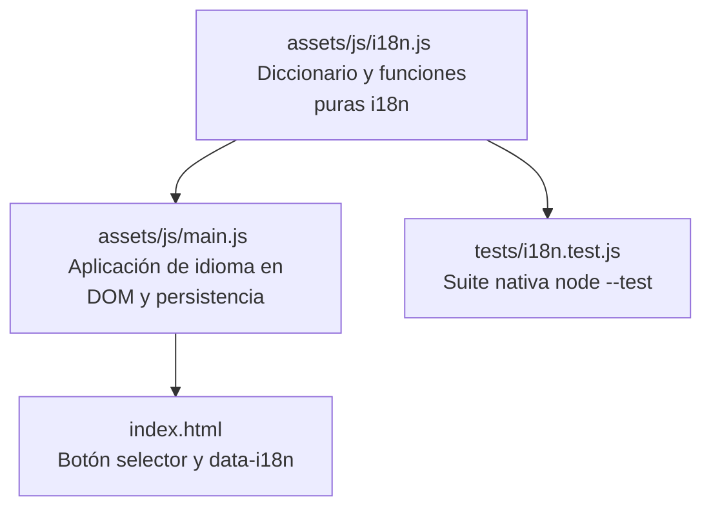

# Plan Técnico: Spec 002 — Selector de Idioma Bilingüe de Interfaz

## 1. Arquitectura y responsabilidades de archivos

### Archivos involucrados:
1. **`assets/js/i18n.js` (Nuevo):** Diccionario bilingüe y funciones puras de resolución, validación y obtención de traducciones.
2. **`tests/i18n.test.js` (Nuevo):** Pruebas unitarias nativas con `node --test`.
3. **`index.html`:** Marcado de los botones `#lang-toggle` y `#lang-toggle-mobile`, atributos `data-i18n` en elementos traducibles de la interfaz.
4. **`assets/js/main.js`:** Integración de la inicialización, evento de conmutación, actualización de elementos del DOM y persistencia en `localStorage` bajo `cv-web-lang`.

---

## 2. Diccionario y Funciones Puras (`assets/js/i18n.js`)

| Función | Parámetros | Retorno | Cobertura RF |
| :--- | :--- | :--- | :--- |
| `esIdiomaValido(lang)` | `(lang: string)` | `boolean` (solo `"es"` o `"en"`) | RF-1.4 |
| `resolverIdiomaInicial(guardado, navLang)` | `(guardado: string, navLang: string)` | `"es"` o `"en"` con prioridad a lo guardado o navegador | RF-1.1, RF-1.2, RF-1.3, RF-1.4 |
| `obtenerTraduccion(clave, lang)` | `(clave: string, lang: string)` | `string` traducido con fallback a español | RF-3.1 |
| `obtenerDiccionario(lang)` | `(lang: string)` | `Object` con el catálogo completo del idioma | RF-3.1 |

---

## 3. Claves de internacionalización (`data-i18n`)

- **Navegación:** `nav_home`, `nav_summary`, `nav_pillars`, `nav_projects`, `nav_skills`, `nav_experience`, `nav_certs`, `nav_contact`.
- **Botones Hero:** `cta_projects`, `cta_whatsapp`, `cta_copy_email`, `cta_email_copied`, `cta_download_cv`, `cta_profile_badge`.
- **Buscador:** `search_title`, `search_subtitle`, `search_placeholder`, `search_suggestions_label`, `search_empty_title`, `search_empty_desc`, `search_empty_reset`.
- **Insignias de sección:** `tag_pillars`, `tag_projects`, `tag_skills`, `tag_experience`, `tag_certs`, `tag_profile`.
- **Toasts:** `toast_lang_switched_es`, `toast_lang_switched_en`.

---

## 4. Decisiones justificadas

1. **Atributos declarativos `data-i18n` en HTML**:
   - *Decisión:* Marcar los elementos del DOM con atributos semánticos para que una sola función iterativa actualice el texto sin acoplar selectores específicos.
   - *Alternativa descartada:* Modificar cada elemento uno a uno por ID en JavaScript, lo que creaba fragilidad ante cambios de maquetación.
2. **Detección automática respetando selección del usuario**:
   - *Decisión:* Evaluar primero `localStorage.getItem('cv-web-lang')`. Si no existe, revisar si `navigator.language` empieza por `"en"`. Si no, recurrir a `"es"`.
   - *Alternativa descartada:* Forzar siempre español ignorando la configuración del navegador de usuarios extranjeros.
